## Armada Theme for VS Code

The extension has two color themes, both optimized for VS Code's modern UI.

- **Armada Dark** is inspired by the dark themes of JetBrains Fleet and Air, both now deprecated. It colors the workbench after the Islands look of the [Armada theme for JetBrains IDEs](https://plugins.jetbrains.com/plugin/26844-armada-theme).
- **Armada Light** is its light counterpart, colored after Armada Light for JetBrains IDEs.

### Picking a theme

Run **Preferences: Color Theme** from the Command Palette and pick **Armada Dark** or **Armada Light**. In `settings.json` the dark theme is named `Armada`, as it was before the light theme existed:

```json
"workbench.colorTheme": "Armada"
```

```json
"workbench.colorTheme": "Armada Light"
```

To follow the operating system's light and dark mode, use both:

```json
"window.autoDetectColorScheme": true,
"workbench.preferredDarkColorTheme": "Armada",
"workbench.preferredLightColorTheme": "Armada Light"
```

### Screenshots

With the theme alone, on VS Code's modern UI with pill tabs:

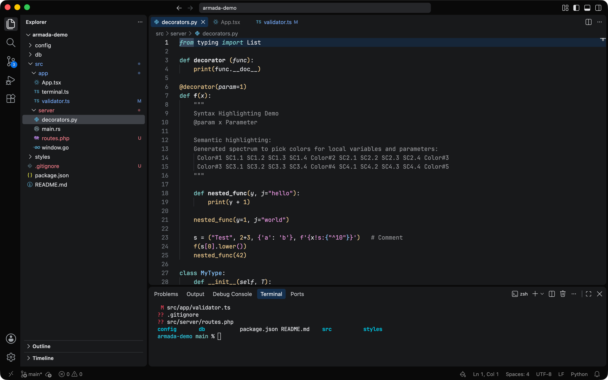

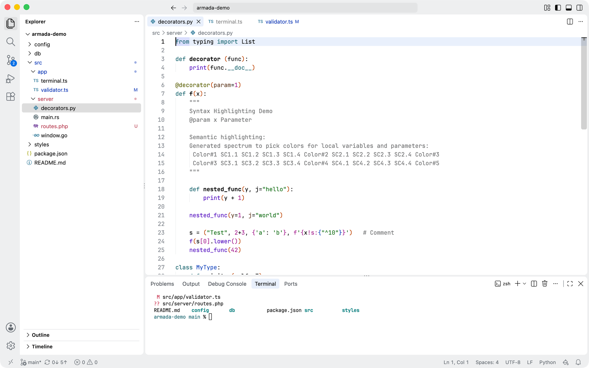

With the [optional custom CSS](#optional-custom-css), which rounds the side bar and outlines the selected tabs:

<table>
  <tr>
    <th>Armada Dark</th>
    <th>Armada Light</th>
  </tr>
  <tr>
    <td><a href="https://github.com/DavidSeptimus/armada-theme-vscode-extension/raw/HEAD/images/split-editors.png">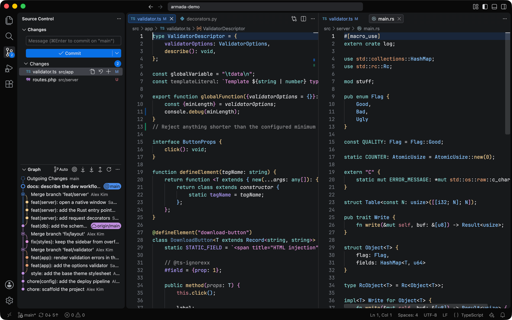</a></td>
    <td><a href="https://github.com/DavidSeptimus/armada-theme-vscode-extension/raw/HEAD/images/split-editors-light.png">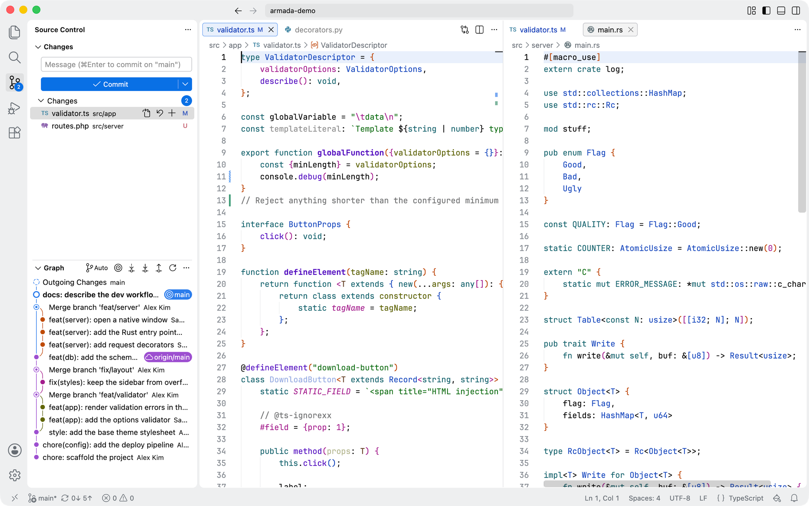</a></td>
  </tr>
  <tr>
    <td><a href="https://github.com/DavidSeptimus/armada-theme-vscode-extension/raw/HEAD/images/diff.png">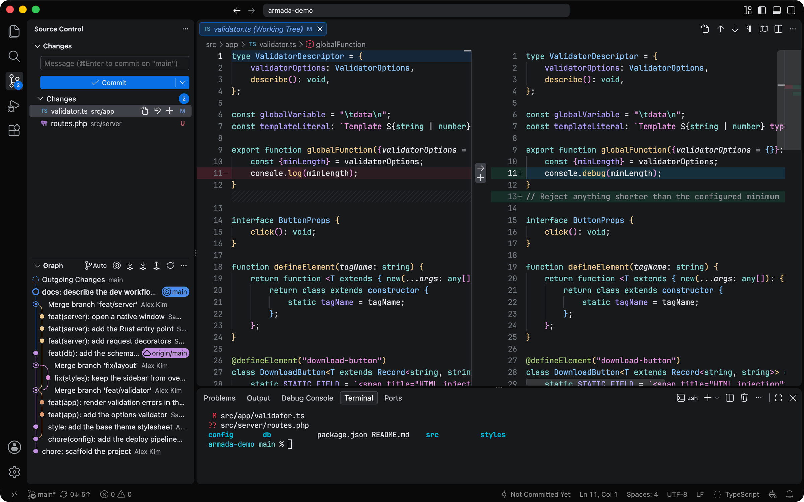</a></td>
    <td><a href="https://github.com/DavidSeptimus/armada-theme-vscode-extension/raw/HEAD/images/diff-light.png">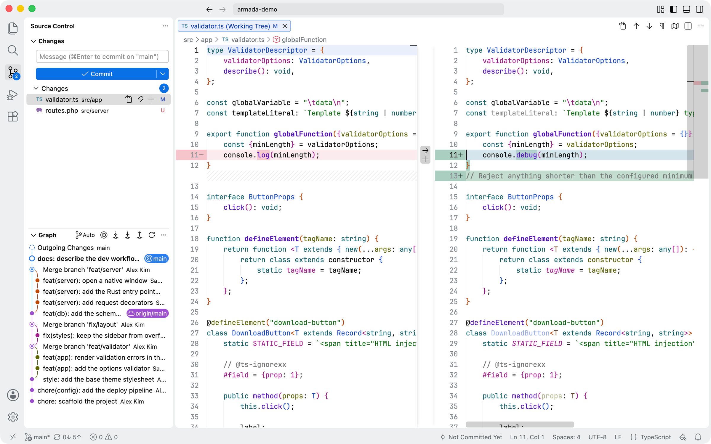</a></td>
  </tr>
  <tr>
    <td><a href="https://github.com/DavidSeptimus/armada-theme-vscode-extension/raw/HEAD/images/command-palette.png">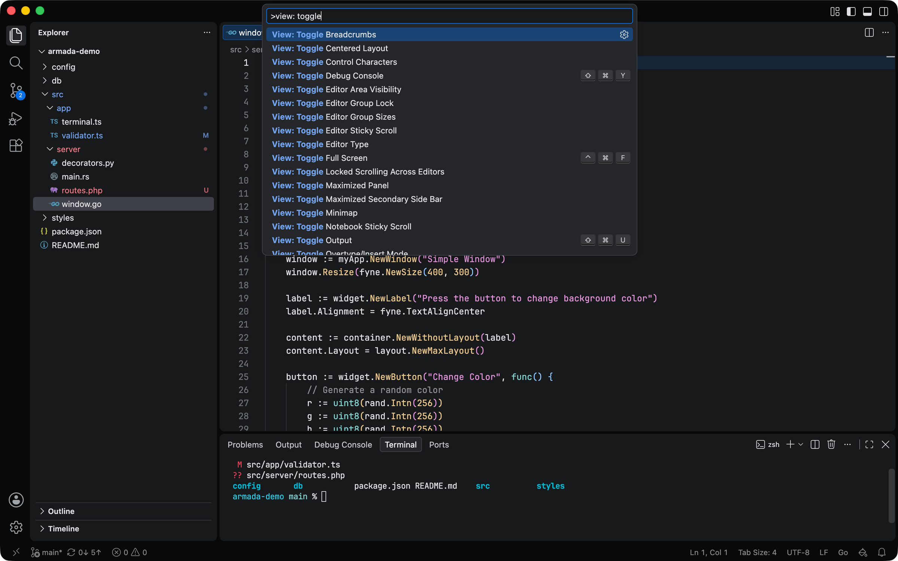</a></td>
    <td><a href="https://github.com/DavidSeptimus/armada-theme-vscode-extension/raw/HEAD/images/command-palette-light.png">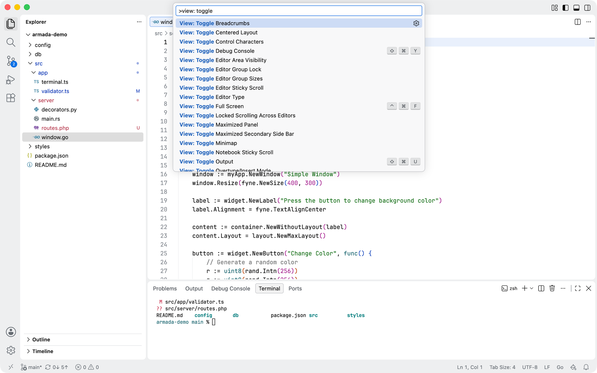</a></td>
  </tr>
  <tr>
    <td><a href="https://github.com/DavidSeptimus/armada-theme-vscode-extension/raw/HEAD/images/settings.png">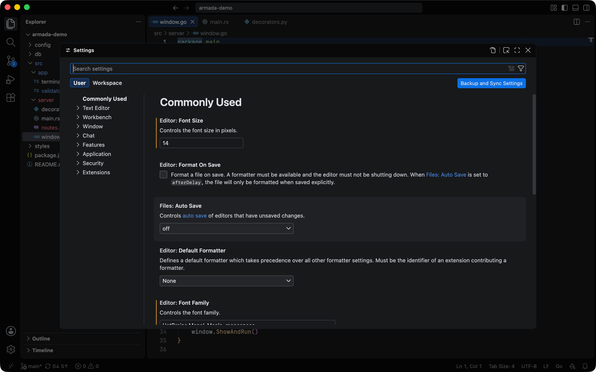</a></td>
    <td><a href="https://github.com/DavidSeptimus/armada-theme-vscode-extension/raw/HEAD/images/settings-light.png">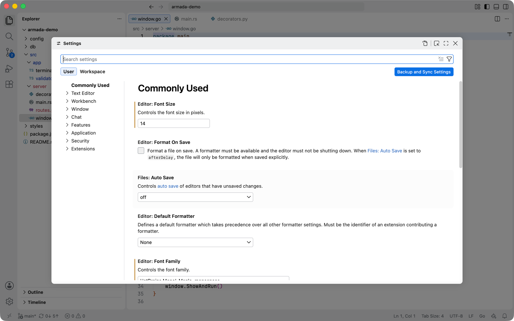</a></td>
  </tr>
  <tr>
    <td><a href="https://github.com/DavidSeptimus/armada-theme-vscode-extension/raw/HEAD/images/git-history.png">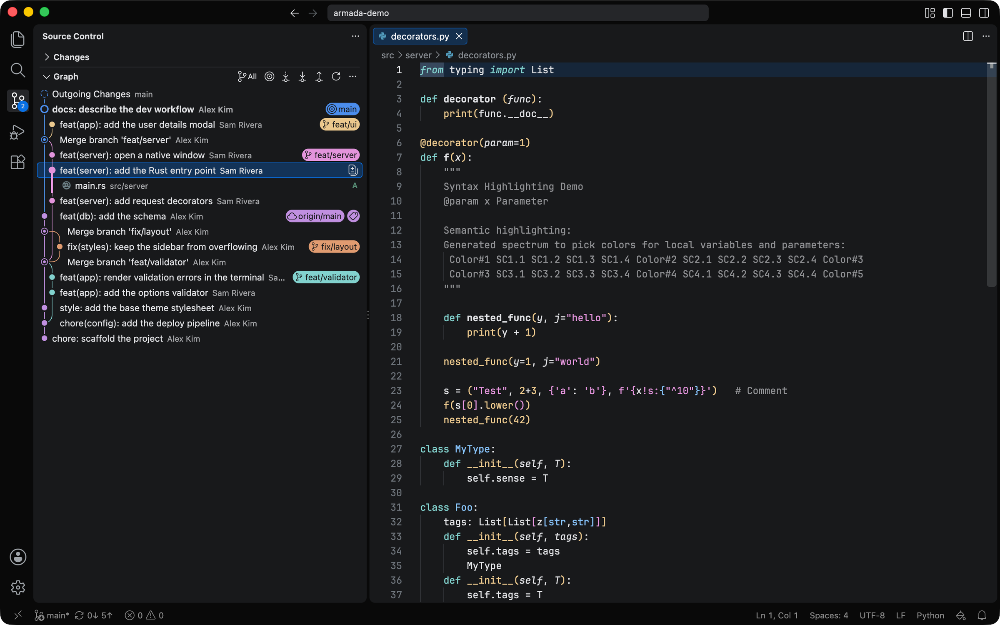</a></td>
    <td><a href="https://github.com/DavidSeptimus/armada-theme-vscode-extension/raw/HEAD/images/git-history-light.png">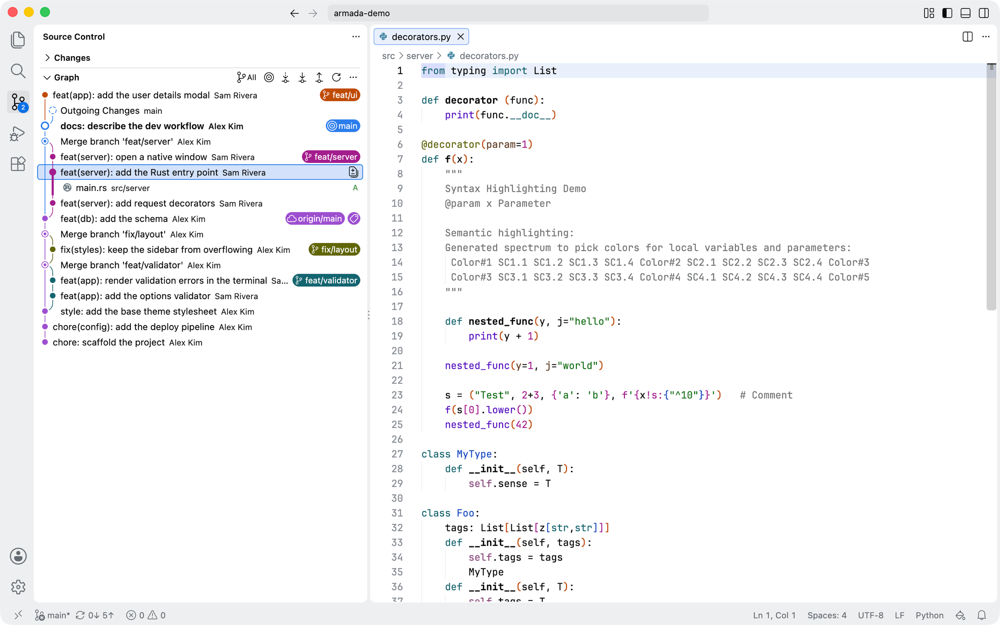</a></td>
  </tr>
</table>

An agent session in the Chat view, in Armada Dark:

<a href="https://github.com/DavidSeptimus/armada-theme-vscode-extension/raw/HEAD/images/chat.png">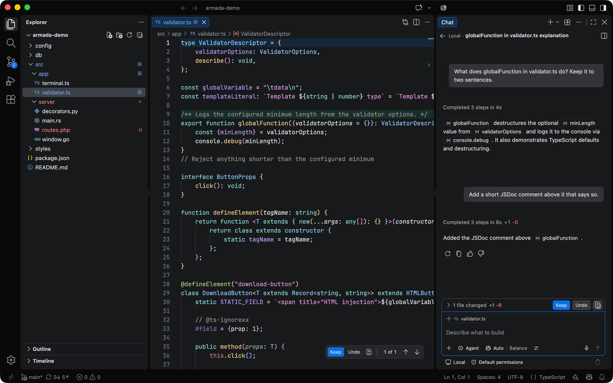</a>

### Islands-style tabs

With VS Code's modern UI, set the editor tabs to pills to get tabs like the ones in JetBrains' Islands themes:

```json
"workbench.experimental.modernUIEditorTabStyle": "pill"
```

### Semantic highlighting

Both themes turn semantic highlighting on, so languages are colored from what their language server knows about the code. Java and Kotlin, with JetBrains' [Java and Kotlin by IntelliJ IDEA](https://marketplace.visualstudio.com/items?itemName=JetBrains.intellij-server), are colored to match Armada for JetBrains IDEs. To go back to grammar-only colors, for every language or one:

```json
"editor.semanticHighlighting.enabled": false,
"[typescript]": { "editor.semanticHighlighting.enabled": false }
```

### Optional custom CSS

VS Code's theme colors can't express two parts of the Islands look, so [custom.css](./custom.css) adds them for anyone who already uses an extension that loads custom CSS into VS Code, such as [Custom CSS and JS Loader](https://marketplace.visualstudio.com/items?itemName=be5invis.vscode-custom-css). It applies only while Armada Dark or Armada Light is the active theme, and draws both the same way, each in its own colors.

- **Rounded side bar.** Armada's activity bar sits on the window's shell, as the tool window stripe does in JetBrains IDEs. VS Code rounds the activity bar's outer corners and leaves the side bar's square beside it, so the side bar looks cut off. The CSS rounds the side bar's outer corners.
- **Outlined tabs.** Armada fills the selected tab, but VS Code has no color for an outline on the selected tab only. The CSS outlines the selected editor tab, the selected tab of the panel, side bars, Settings editor and chat model picker, and the selected choice of a chat question. Tabs are blue where the focus is and grey elsewhere.

With Custom CSS and JS Loader: save `custom.css`, add it to `vscode_custom_css.imports` in your settings as a `file://` URL, run **Enable Custom CSS and JS** from the Command Palette, and restart VS Code.

Custom CSS patches VS Code's own files: VS Code reports the installation as unsupported, and the patch has to be applied again after each update. The selectors target VS Code 1.145's experimental modern UI and may need updating in later versions.

### Other Armada implementations

- [JetBrains IDEs](https://plugins.jetbrains.com/plugin/26844-armada-theme)
- [Tachi Code](https://tachicode.com)
