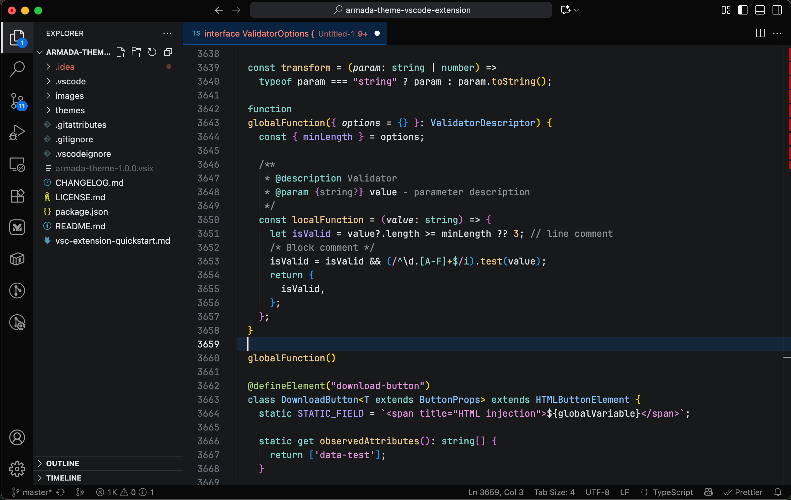
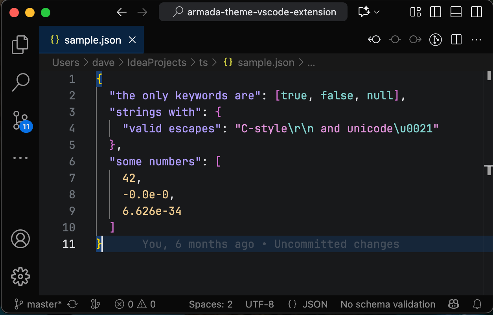
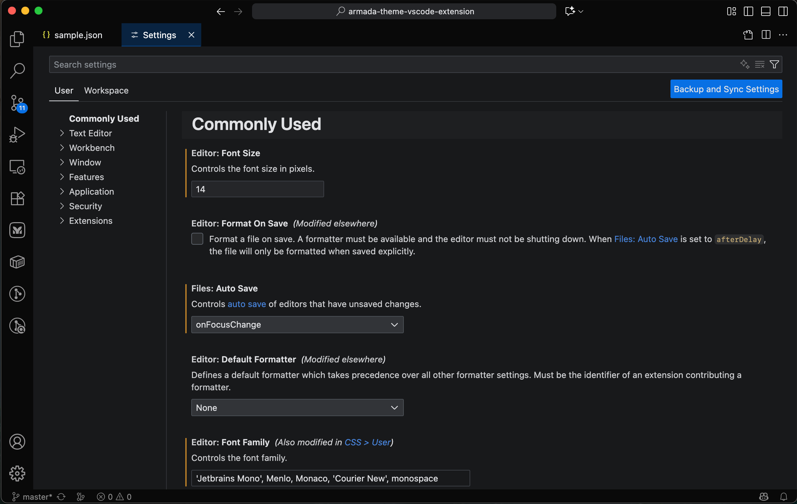
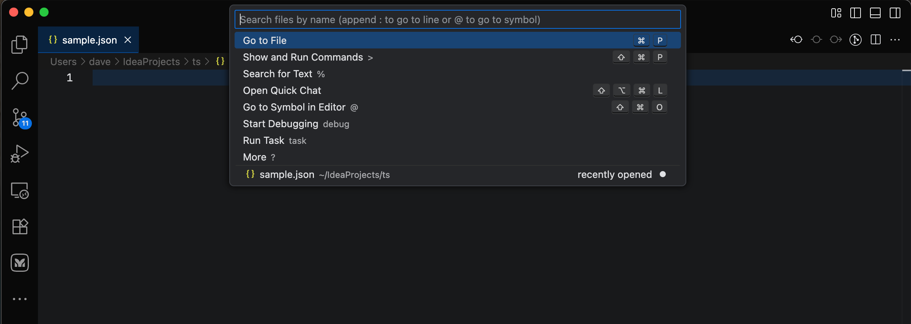

## Armada Theme for VS Code

Armada is a theme initially developed for [Tachi Code](https://tachicode.com) adapted from the dark theme from JetBrains Fleet.

Tachi Code borrows VS Code's theme system, so repackaging this theme for VS Code is relatively low effort.


### Screenshots 






### Islands-style tabs

With VS Code's modern UI, set the editor tabs to pills to get tabs like the ones in JetBrains' Islands themes:

```json
"workbench.experimental.modernUIEditorTabStyle": "pill"
```

Armada fills the active pill, and the selected tab of the panel, side bars, Settings editor and chat model picker, but VS Code has no color for an outline on those tabs only. If you already use an extension that loads custom CSS into VS Code (such as [Custom CSS and JS Loader](https://marketplace.visualstudio.com/items?itemName=be5invis.vscode-custom-css)), this adds the outline, tints the tab blue only where the focus is, gives the selected choice of a chat question the same treatment, and applies only while Armada is the active theme:

```css
/* Armada: outline the active editor tab */
.DavidSeptimus-armada-theme-themes-Armada-color-theme-json.modern-ui-tabs
  .part.editor .tabs-container > .tab.active > .tab-fill {
  border-color: #0870e480;
}

/* The active tab of an editor group that doesn't have focus */
.DavidSeptimus-armada-theme-themes-Armada-color-theme-json.modern-ui-tabs
  .part.editor .editor-group-container:not(.active) .tabs-container > .tab.active > .tab-fill {
  border-color: #3e4147;
  background-color: #252629 !important;
}

/* Armada: outline the selected tab of the panel and side bars */
.DavidSeptimus-armada-theme-themes-Armada-color-theme-json.modern-ui-tabs
  .pane-composite-part > :is(.title, .header-or-footer) > .composite-bar-container
  > .composite-bar > .monaco-action-bar .action-item:not(.icon).checked > .active-item-indicator {
  box-shadow: inset 0 0 0 1px #3e4147;
  background-color: #252629 !important;
}

/* The same tab while its panel or side bar has focus */
.DavidSeptimus-armada-theme-themes-Armada-color-theme-json.modern-ui-tabs
  .pane-composite-part:focus-within > :is(.title, .header-or-footer) > .composite-bar-container
  > .composite-bar > .monaco-action-bar .action-item:not(.icon).checked > .active-item-indicator {
  box-shadow: inset 0 0 0 1px #0870e480;
  background-color: #0870e440 !important;
}

/* Armada: outline the selected scope tab of the Settings editor */
.DavidSeptimus-armada-theme-themes-Armada-color-theme-json.modern-ui-tabs
  .settings-editor .settings-tabs-widget > .monaco-action-bar .action-item .action-label.checked {
  box-shadow: inset 0 0 0 1px #0870e480;
}

/* Armada: outline the selected tab of the chat model picker */
.DavidSeptimus-armada-theme-themes-Armada-color-theme-json
  .action-widget .chat-model-picker-tabbar .monaco-custom-radio .monaco-button.active,
.DavidSeptimus-armada-theme-themes-Armada-color-theme-json
  .action-widget.search-mode .chat-model-picker-tabbar .tabbed-action-list-tabbar-action.checked {
  box-shadow: inset 0 0 0 1px #0870e480;
}

/* Armada: the selected choice of a chat question, as IntelliJ's AI Assistant draws it */
.DavidSeptimus-armada-theme-themes-Armada-color-theme-json .interactive-session
  .chat-question-carousel-container .chat-question-input-container
  .chat-question-list .chat-question-list-item.selected,
.DavidSeptimus-armada-theme-themes-Armada-color-theme-json .interactive-session
  .chat-question-carousel-container .chat-question-input-container
  .chat-question-list:not(:focus) .chat-question-list-item.selected:hover {
  background-color: #18263c;
  box-shadow: inset 0 0 0 1px #225090;
}

/* The same choice while the list has keyboard focus */
.DavidSeptimus-armada-theme-themes-Armada-color-theme-json .interactive-session
  .chat-question-carousel-container .chat-question-input-container
  .chat-question-list:focus .chat-question-list-item.selected {
  background-color: #18263c;
  box-shadow: inset 0 0 0 1px #2a7deb;
}

/* Its number */
.DavidSeptimus-armada-theme-themes-Armada-color-theme-json .interactive-session
  .chat-question-carousel-container .chat-question-input-container
  .chat-question-list .chat-question-list-item.selected .chat-question-list-number,
.DavidSeptimus-armada-theme-themes-Armada-color-theme-json .interactive-session
  .chat-question-carousel-container .chat-question-input-container
  .chat-question-list:focus .chat-question-list-item.selected .chat-question-list-number {
  color: #a8c6f4;
}
```

Custom CSS patches VS Code's own files: VS Code reports the installation as unsupported, and the patch has to be applied again after each update. The selectors target VS Code 1.145's experimental modern UI and may need updating in later versions.

### Other Armada  Implementations

- [Tachi Code](https://tachicode.com)
- [JetBrains IDEs](https://plugins.jetbrains.com/plugin/26844-armada-theme)